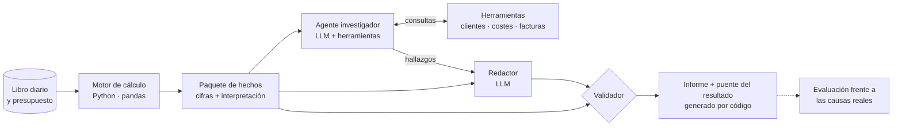

# Variance Analyst: analista de desviaciones con IA

*[Read in English](README.md)*

Genera el comentario mensual de desviaciones (real frente a presupuesto) de una empresa a partir de su
contabilidad: calcula las causas, **investiga** las anomalías consultando los datos y redacta un informe
para el comité de dirección. Un validador automático comprueba que ninguna cifra del informe sea inventada
ni esté mal interpretada.

Funciona con un **modelo de lenguaje local** (Ollama + Qwen 2.5), así que los datos financieros no salen
del ordenador. Cambiando dos líneas de configuración funciona también con Claude.

> **Resultado:** en 3 ejecuciones de la configuración final, **0 errores en las cifras** y **9,7 de 10 causas
> reales identificadas** de media, incluidas dos que no se ven en los totales (la pérdida de un cliente
> clave y un error de contabilización).

---

## El problema

Explicar por qué el resultado se aparta del presupuesto es una de las tareas más repetitivas del control
de gestión: descomponer cada desviación, buscar la causa en el detalle y redactarla para dirección.
Un LLM puede redactar, pero en finanzas tiene dos riesgos graves:

1. **Inventar o calcular mal cifras.** Los modelos de lenguaje no son fiables haciendo aritmética.
2. **Usar cifras correctas con un significado equivocado.** Es el riesgo más peligroso, porque el informe
   *parece* correcto. En la primera versión de este proyecto, el modelo escribía que la plantilla de
   Logística «se había reducido», citando una cifra real… cuando en realidad había aumentado.

Este proyecto es un sistema diseñado para que esos dos errores no lleguen al lector.

## El principio de diseño

> **El modelo de lenguaje nunca calcula ni interpreta signos: redacta a partir de hechos que el código ya
> ha calculado e interpretado, y un validador comprueba que no los contradiga.**

## Ejemplo de salida

Fragmento de un informe real (`docs/informe_ejemplo.md`):

> **Titular.** El resultado antes de impuestos se desvió desfavorablemente en 268.090 € debido
> principalmente a una disminución en el volumen de ventas y un aumento en el coste unitario de compra de
> ciertas categorías.
>
> **Ventas y margen bruto.** El volumen total de unidades vendidas tuvo un efecto desfavorable de
> 211.490 €, principalmente debido a la pérdida de un cliente importante, Papelerías Mediterráneo S.A., que
> dejó de comprar desde junio. […]
>
> **Hallazgos de la investigación.** *Coste unitario de compra: Material de oficina.* El coste unitario en
> enero fue anómalo debido a la contabilización de una factura del ejercicio anterior. Evidencia: la
> factura FR25-00240, emitida el 31/12/2025, se contabilizó el 02/01/2026.

Lo que parecía un encarecimiento de 62.479 € del material de oficina era, en realidad, un **error de corte
de operaciones**. El agente lo encontró por sí mismo: vio que enero era anómalo, consultó las facturas de
ese mes y comparó la fecha de factura con la de contabilización.

## Arquitectura



| Pieza | Archivo | Qué hace |
|---|---|---|
| Carga de datos | `carga.py` | Lee diario, facturas, plantilla y presupuesto. Única pieza que sabe de dónde vienen los datos. |
| Motor de cálculo | `ventas.py`, `margen.py`, `personal.py`, `gastos.py` | Descompone cada desviación en sus efectos (volumen, mix, precio, coste unitario, plantilla, presupuesto flexible…). Cada análisis comprueba que sus efectos suman exactamente la desviación. |
| Paquete de hechos | `hechos.py` | Une los análisis, **comprueba que explican al euro el resultado del libro diario** y traduce cada cifra a palabras (favorable/desfavorable, por encima/por debajo del presupuesto). Construye el puente del resultado. |
| Agente | `agente.py`, `herramientas.py` | El modelo pide consultas (*tool calling*), el código las ejecuta y le devuelve el resultado. Las herramientas señalan anomalías y sugieren el siguiente paso. Todo queda registrado en una traza auditable. |
| Redacción | `prompts.py`, `llm.py` | Instrucciones versionadas (v1 → v4) y acceso al modelo, independiente del proveedor (Ollama o Claude). |
| Validador | `validador.py` | Revisa cada cifra del texto: que exista, que su valoración y su dirección sean correctas y que su unidad lo sea. Mide qué impulsores se mencionan y cuáles se cuantifican. |
| Evaluación | `evaluacion.py`, `experimento.py` | Puntúa cada informe frente a las 10 causas sembradas en los datos y repite el experimento N veces. |

## Resultados

### Evolución del sistema

Cada versión nace de un error real de la anterior.

| Versión | Qué cambió | Modelo | Errores en cifras | Impulsores cuantificados | Causas reales |
|---|---|---|---:|---:|---:|
| v1 | Prompt con los hechos en bruto | Qwen 2.5 7B | 9 | 9 % | 3 / 10 |
| v1 | Mismo prompt, modelo el doble de grande | Qwen 2.5 14B | 4 | 0 % | 2 / 10 |
| v2 | El motor interpreta cada cifra; el modelo solo la copia | 14B | **0** | 0 % | 6 / 10 |
| v3 | Importes ya formateados + puente generado por código | 14B | 0 | 91 % | 7 / 10 |
| v3 + agente | El agente investiga con herramientas | 14B | 0 | 55 % | 8 / 10 |
| v3 + agente | Las herramientas sugieren el siguiente paso | 14B | 0 | 55 % | 9 / 10 |
| **v4** | **Investigar antes de redactar** + regla de calendario | 14B | **0** | 79 % (55–91 %) | **9,7 / 10** (9–10) |

Hasta la v3 + agente son ejecuciones únicas. La v4 es la media (y el rango) de 3 ejecuciones.

**Conclusión principal:** pasar a un modelo el doble de grande redujo los errores de 9 a 4.
Cambiar la arquitectura (qué calcula el código, qué copia el modelo y qué se valida) los llevó a 0.

### Configuración final (v4, Qwen 2.5 14B, 3 ejecuciones)

| Métrica | Media | Rango |
|---|---:|---:|
| Errores en cifras | 0 | 0 – 0 |
| Impulsores mencionados | 88 % | 82 – 91 % |
| Impulsores cuantificados | 79 % | 55 – 91 % |
| Causas reales identificadas | 9,7 / 10 | 9 – 10 |
| Minutos por informe (mediana, portátil sin GPU dedicada) | 13,5 | — |

## Decisiones de diseño

1. **Todo lo que pueda calcular el código, lo calcula el código.** Incluida la interpretación: el motor
   entrega «por encima del presupuesto», no un signo negativo que el modelo tenga que descifrar.
2. **Las cifras exactas no pasan por el modelo.** El puente del resultado es una tabla generada por código;
   el modelo solo aporta la narrativa.
3. **Validar el significado, no solo la cifra.** Un validador que solo comprobara que las cifras existen
   habría aprobado al 100 % el informe que decía que la plantilla se había reducido.
4. **Conciliación contra la contabilidad.** Si un análisis deja fuera una sola cuenta, el programa se
   detiene: el resultado que reconstruye el motor tiene que coincidir con el del libro diario.
5. **Investigar antes de redactar.** En la v3, la narrativa presentaba como subida de precios lo que el
   agente demostraba, líneas más abajo, que era un error contable.
6. **Herramientas que guían.** Detectar una anomalía es aritmética; lo hace la herramienta, que además
   indica la siguiente consulta. Una pista en el resultado funciona mejor que una regla en el prompt.
7. **Evaluar con reglas deterministas y varias ejecuciones.** Con la misma configuración, la cobertura
   osciló entre el 55 % y el 91 %: una sola ejecución no permite sacar conclusiones.

## Limitaciones

- **Las afirmaciones sin cifra no se validan.** En una ejecución, el modelo propuso «reducir el coste medio
  de Logística», que en realidad fue favorable.
- **Cifras correctas mal conectadas.** El modelo atribuyó en una ocasión la desviación de *ventas* de una
  categoría a su coste de compra, que no afecta a las ventas. La cifra y su valoración eran correctas.
- **«Puntos a investigar» no siempre respeta los hallazgos:** a veces vuelve a preguntar lo que el agente
  ya respondió.
- **El validador y la evaluación usan reglas de palabras clave y proximidad.** Son transparentes y
  reproducibles, pero pueden dar algún falso positivo o falso negativo.
- **Datos sintéticos.** La contabilidad es de una empresa ficticia, generada con causas conocidas para
  poder medir los resultados. En una empresa real no hay *ground truth*: la evaluación sería por revisión
  de un controller.

## Datos

Contabilidad sintética de **Grafilia Distribución S.L.** (empresa ficticia), una distribuidora mayorista de
papelería: unos 4.000 asientos en partida doble según el PGC 2007, libros de IVA, nóminas, cierre de 2025,
2026 hasta septiembre y presupuesto 2026 construido por drivers.

En los datos se sembraron **10 causas de desviación conocidas** (pérdida de un cliente clave, subida de
tarifa de un proveedor, cambio de mix, plantilla adelantada, error de corte…). Están en
`evaluacion/ground_truth/`, fuera de la carpeta de datos que lee el sistema: el modelo nunca las ve.

Los datos son totalmente reproducibles: `scripts/generar_contabilidad.py` regenera todos los CSV (con una
semilla aleatoria fija) y comprueba que todos los asientos cuadran y que las ventas del diario coinciden con el libro de
facturas emitidas. `scripts/schema.sql` los carga en PostgreSQL / Supabase con vistas de mayor, sumas y saldos y
real frente a presupuesto.

## Cómo ejecutarlo

Requisitos: Python 3.11 o superior y [Ollama](https://ollama.com) (unos 16 GB de RAM para el modelo de 14B).

```bash
# 1. Dependencias
pip install -r requirements.txt

# 2. Modelos locales (la configuración de cada uno está en su Modelfile)
ollama pull qwen2.5:14b
ollama create qwen2.5-14b-16k -f Modelfile.14b

# 3. Configuración: crear un archivo .env en la raíz con
#    PROVEEDOR_LLM=ollama
#    MODELO_LLM=qwen2.5-14b-16k

# 4. Ejecutar (desde src/)
cd src
python hechos.py              # solo el motor de cálculo -> salidas/hechos_desviaciones.json
python agente.py              # solo la investigación
python informe.py             # informe completo -> salidas/informe_<modelo>_<fecha>.md
python evaluacion.py ../salidas/<informe>.md
python experimento.py 3       # 3 ejecuciones + resumen en salidas/experimentos.csv
```

Para usar Claude en lugar de un modelo local: `PROVEEDOR_LLM=anthropic`, `MODELO_LLM=<modelo>` y
`ANTHROPIC_API_KEY=...` en el `.env`.

## Estructura del repositorio

```
variance-analyst/
├── datos/                  # contabilidad sintética (CSV) y supuestos del presupuesto
├── scripts/                # generador de los datos y esquema PostgreSQL
├── evaluacion/ground_truth # causas sembradas: nunca se dan al modelo
├── src/                    # motor, agente, redacción, validador y evaluación
├── notebooks/              # exploración paso a paso del motor de cálculo
├── salidas/                # informes generados, trazas del agente y resultados de los experimentos
├── docs/                   # informe de ejemplo
├── Modelfile, Modelfile.14b
└── requirements.txt
```

## Próximos pasos

- Leer los datos desde PostgreSQL / Supabase en lugar de CSV (solo cambia `carga.py`).
- Más herramientas para el agente: desviaciones por cliente y categoría, detalle de nóminas.
- Comparativa con modelos en la nube (Claude) usando el mismo `experimento.py`.
- Un cuadro de mando que muestre el puente del resultado junto al comentario.
