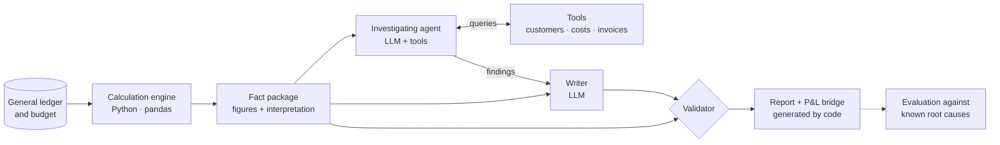

# Variance Analyst: AI-assisted budget variance commentary

*[Leer en español](README.es.md)*

Generates the monthly actual-vs-budget variance commentary for a company straight from its accounting
records: it computes the drivers of each variance, **investigates** anomalies by querying the data, and
writes a report for the management committee. An automated validator checks that no figure in the report
is invented or misinterpreted.

It runs on a **local language model** (Ollama + Qwen 2.5), so financial data never leaves the machine.
Changing two configuration lines switches it to Claude.

> **Result:** across 3 runs of the final configuration, **zero figure errors** and **9.7 out of 10 real
> root causes identified** on average, including two that are invisible in the totals (the loss of a key
> customer and an accounting cut-off error).

---

## The problem

Explaining why results deviate from budget is one of the most repetitive tasks in FP&A and management
control: decompose every variance, dig into the detail for the cause, and write it up for leadership.
An LLM can write, but in finance it carries two serious risks:

1. **Inventing or miscalculating figures.** Language models are unreliable at arithmetic.
2. **Using correct figures with the wrong meaning.** This is the more dangerous risk, because the report
   *looks* right. In the first version of this project, the model wrote that Logistics headcount had
   "decreased", quoting a real figure, when it had actually increased.

This project is a system designed so that neither error reaches the reader.

## Design principle

> **The language model never calculates and never interprets signs. It writes from facts that code has
> already computed and interpreted, and a validator checks it does not contradict them.**

## Sample output

Excerpt from a real report (`docs/informe_ejemplo.md`; reports are generated in Spanish, translated here):

> **Headline.** Profit before tax came in €268,090 below budget, mainly due to lower sales volume and higher
> unit purchase costs in certain categories.
>
> **Sales and gross margin.** Total units sold had an unfavourable impact of €211,490, mainly due to the
> loss of a major customer, Papelerías Mediterráneo S.A., which stopped buying in June. […]
>
> **Investigation findings.** *Unit purchase cost: Office supplies.* The January unit cost was anomalous
> because an invoice from the previous financial year was booked in it. Evidence: invoice FR25-00240,
> dated 31/12/2025, was posted on 02/01/2026.

What looked like a €62,479 increase in office-supply costs was in fact a **cut-off error**. The agent found
it on its own: it saw that January was anomalous, pulled that month's invoices and compared invoice dates
with posting dates.

## Architecture



| Component | File | What it does |
|---|---|---|
| Data loading | `carga.py` | Reads the ledger, invoices, headcount and budget. The only piece that knows where the data comes from. |
| Calculation engine | `ventas.py`, `margen.py`, `personal.py`, `gastos.py` | Decomposes each variance into its drivers (volume, mix, price, unit cost, headcount, flexible budget…). Each analysis checks that its effects add up exactly to the variance. |
| Fact package | `hechos.py` | Combines the analyses, **checks they reconcile to the cent with profit per the general ledger**, and translates every figure into words (favourable/unfavourable, above/below budget). Builds the profit bridge. |
| Agent | `agente.py`, `herramientas.py` | The model requests queries (*tool calling*), the code runs them and returns the result. Tools flag anomalies and suggest the next step. Every query is logged in an auditable trace. |
| Writing | `prompts.py`, `llm.py` | Versioned instructions (v1 → v4) and provider-agnostic model access (Ollama or Claude). |
| Validator | `validador.py` | Checks every figure in the text: that it exists, that its assessment, direction and unit are correct. Measures which drivers are mentioned and which are quantified. |
| Evaluation | `evaluacion.py`, `experimento.py` | Scores each report against the 10 root causes seeded in the data and repeats the experiment N times. |

## Results

### How the system evolved

Each version was driven by a real failure in the previous one.

| Version | What changed | Model | Figure errors | Drivers quantified | Root causes found |
|---|---|---|---:|---:|---:|
| v1 | Prompt with raw facts | Qwen 2.5 7B | 9 | 9% | 3 / 10 |
| v1 | Same prompt, model twice the size | Qwen 2.5 14B | 4 | 0% | 2 / 10 |
| v2 | Engine interprets every figure; model only copies | 14B | **0** | 0% | 6 / 10 |
| v3 | Pre-formatted amounts + bridge generated by code | 14B | 0 | 91% | 7 / 10 |
| v3 + agent | Agent investigates with tools | 14B | 0 | 55% | 8 / 10 |
| v3 + agent | Tools suggest the next step | 14B | 0 | 55% | 9 / 10 |
| **v4** | **Investigate before writing** + timing rule | 14B | **0** | 79% (55–91%) | **9.7 / 10** (9–10) |

Rows up to v3 + agent are single runs. v4 is the mean (and range) of 3 runs.

**Key takeaway:** doubling the model size cut errors from 9 to 4. Changing the architecture (what the code
computes, what the model copies and what gets validated) brought them to 0.

### Final configuration (v4, Qwen 2.5 14B, 3 runs)

| Metric | Mean | Range |
|---|---:|---:|
| Figure errors | 0 | 0 – 0 |
| Drivers mentioned | 88% | 82 – 91% |
| Drivers quantified | 79% | 55 – 91% |
| Root causes identified | 9.7 / 10 | 9 – 10 |
| Minutes per report (median, laptop without a dedicated GPU) | 13.5 | — |

## Design decisions

1. **Whatever code can compute, code computes.** Including interpretation: the engine hands over "above
   budget", not a negative sign the model has to decode.
2. **Exact figures never go through the model.** The profit bridge is a table generated by code; the model
   only contributes the narrative.
3. **Validate meaning, not just figures.** A validator that only checked figures exist would have passed,
   at 100%, the report claiming headcount had fallen.
4. **Reconcile to the books.** If an analysis leaves out a single account, the program stops: the profit
   rebuilt by the engine must match the general ledger.
5. **Investigate before writing.** In v3, the narrative presented as a price increase what the agent proved,
   a few lines further down, to be an accounting error.
6. **Tools that guide.** Spotting an anomaly is arithmetic, so the tool does it and also names the next
   query. A hint in the tool result works better than a rule in the prompt.
7. **Evaluate with deterministic rules and repeated runs.** With identical configuration, coverage ranged
   from 55% to 91%: a single run is not enough to draw conclusions.

## Limitations

- **Claims without a figure are not validated.** In one run the model suggested "reducing the average cost
  of Logistics", which was in fact favourable.
- **Correct figures, wrong link.** Once, the model attributed a category's *sales* variance to its purchase
  cost, which does not affect sales. The figure and its assessment were correct.
- **"Points to investigate" does not always respect the findings:** it sometimes asks again what the agent
  already answered.
- **The validator and the evaluation rely on keyword and proximity rules.** They are transparent and
  reproducible, but can produce the occasional false positive or negative.
- **Synthetic data.** The accounts belong to a fictitious company, generated with known causes so results
  can be measured. A real company has no ground truth: evaluation would rely on review by a controller.

## Data

Synthetic accounting for **Grafilia Distribución S.L.** (a fictitious company), a stationery wholesaler:
around 4,000 double-entry journal entries under the Spanish GAAP chart of accounts (PGC 2007), VAT books,
payroll, the 2025 year-end close, 2026 actuals through September and a driver-based 2026 budget.

**10 known variance causes** were seeded into the data (loss of a key customer, a supplier price increase,
mix shift, early hires, a cut-off error…). They live in `evaluacion/ground_truth/`, outside the data folder
the system reads: the model never sees them.

## How to run it

Requirements: Python 3.11+ and [Ollama](https://ollama.com) (about 16 GB of RAM for the 14B model).

```bash
# 1. Dependencies
pip install -r requirements.txt

# 2. Local models (each one's settings live in its Modelfile)
ollama pull qwen2.5:14b
ollama create qwen2.5-14b-16k -f Modelfile.14b

# 3. Configuration: create a .env file in the project root with
#    PROVEEDOR_LLM=ollama
#    MODELO_LLM=qwen2.5-14b-16k

# 4. Run (from src/)
cd src
python hechos.py              # calculation engine only -> salidas/hechos_desviaciones.json
python agente.py              # investigation only
python informe.py             # full report -> salidas/informe_<model>_<date>.md
python evaluacion.py ../salidas/<report>.md
python experimento.py 3       # 3 runs + summary in salidas/experimentos.csv
```

To use Claude instead of a local model: set `PROVEEDOR_LLM=anthropic`, `MODELO_LLM=<model>` and
`ANTHROPIC_API_KEY=...` in `.env`.

## Repository structure

```
variance-analyst/
├── datos/                  # synthetic accounting data (CSV) and budget assumptions
├── evaluacion/ground_truth # seeded root causes: never given to the model
├── src/                    # engine, agent, writing, validator and evaluation
├── notebooks/              # step-by-step exploration of the calculation engine
├── salidas/                # generated reports, agent traces and experiment results
├── docs/                   # sample report
├── Modelfile, Modelfile.14b
└── requirements.txt
```

The code, data and generated reports are in Spanish, the working language of the finance team they were
designed for.

## Next steps

- Read data from PostgreSQL / Supabase instead of CSV (only `carga.py` changes).
- More agent tools: variances by customer and category, payroll detail.
- Benchmark against cloud models (Claude) with the same `experimento.py`.
- A dashboard showing the profit bridge alongside the commentary.
